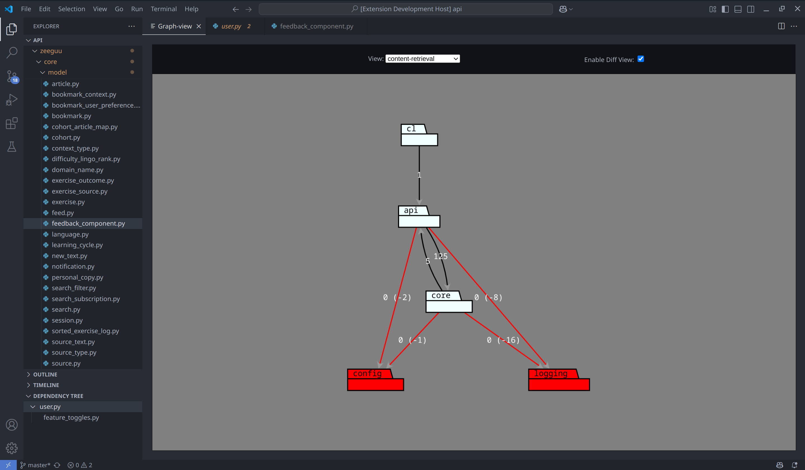
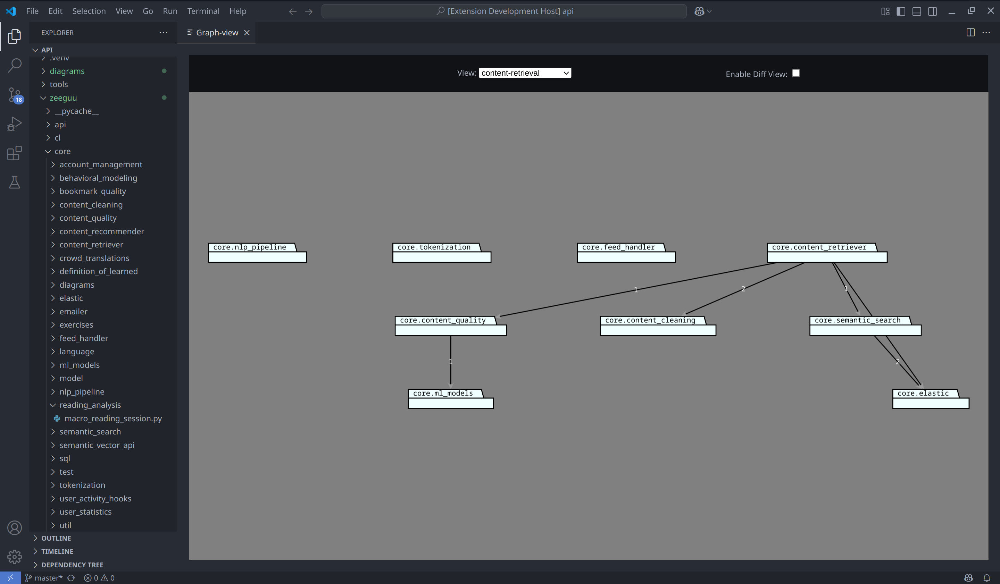
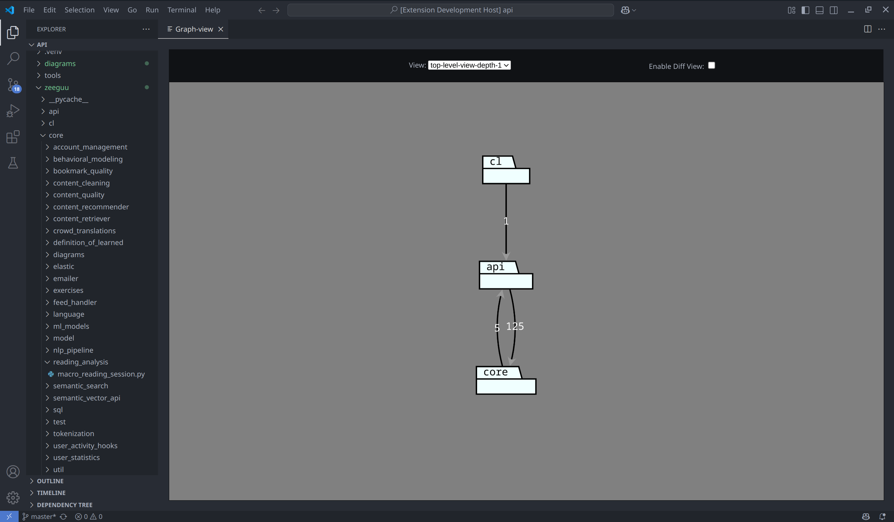

# ArchLens For VSCode
A Visual Studio Code extension that allows you to use ArchLens directly in your editor.

## Installing the extension

### VS Code's official marketplace

The extension can be downloaded from [Visual Studio Codes official markeplace](https://marketplace.visualstudio.com/items?itemName=ArchLens.archlens-for-vscode).

### Using the extension file
Download the `.zip` file from GitHub.
Unzip it, and install the extension by running the command:

    code --install-extension archlens-for-vscode-<version>.vsix

## Setting up the extension

The extension requires you have the [official Python extension installed](https://marketplace.visualstudio.com/items?itemName=ms-python.python) for it to work.

After installing the extension, you can go through a guided setup by opening VS Code's command palette using `control` + `shift` + `p`, and use the command:

    ArchLens: Setup ArchLens

## The extension





## Developing the extension

First install the dependencies required by the extension:

```shell
npm install
```

### Running the extension in development mode

To run the extension in development mode, run:

```shell
npm run watch
```

You can launch a sandbox version of VSCode by pressing `f5`. This will open a new instance of vscode where the extension is running.

Some handy VSCode commands include:

- Shift R: Reloads the VSCode sandbox
- `Open Webview Developer Tools`: Opens a browser-debugger window, that can be used to debug the webview.

### Publishing extension

#### Install the VSCode extension bundler

To be able to package the extension, you need to have NPM installed, and install the VSCode extension bundler with the command:

    npm install -g @vscode/vsce

#### Package the extension

Then, you can bundle the extension into a .vsix file using:

    vsce package